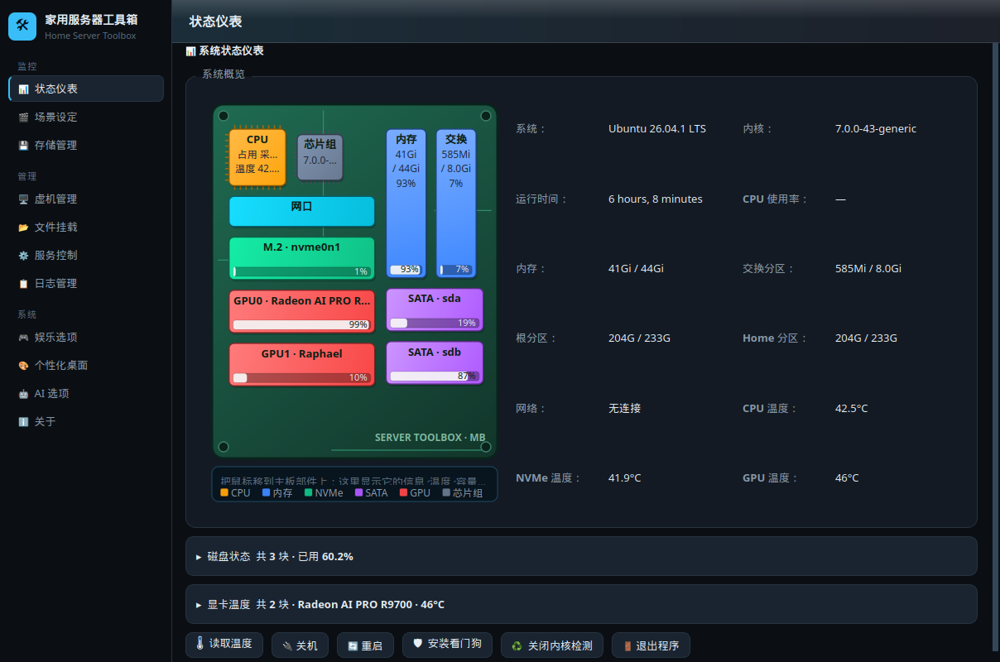

# Home Server Toolbox

[简体中文](README.md) · **English** · [繁體中文](README.zh-TW.md)
<!-- This file mirrors README.md section by section (README.zh-TW.md too). When you
     change one, change all three: headings and code blocks must line up, and inside
     code blocks translate only the comments — never the commands. -->

A Qt6 desktop tool for Linux, for driving the various jobs a home server has to do.



 **Claude and I are sworn enemies**

> The UI is a dark machine-room console style; colour tokens and implementation notes are in
> [doc/THEME.md](doc/THEME.md). There are also 4 styled HTML mock-ups in [doc/demos/](doc/demos/).

## Features

- **📊 Status dashboard** — system resource monitoring (CPU, memory, disks, network)
- **🎬 Scenes** — start / stop chosen services and VMs per time window
  - Add, edit and delete scenes; each has a start time, an end time and repeat weekdays
  - Different scenes can each control several system / user services, plus VMs from the VM manager
  - Timed execution needs the toolbox to stay running; settings live in `~/.config/ServerToolbox/scenes.toml`
- **💾 Storage** — block device tree, partition mounting, S.M.A.R.T health checks
  - **Readiness detection** — compares `/etc/fstab` against what is actually mounted and reports each partition as ready / not ready / not configured
  - **Hidden loop devices** — ISO, Snap and AppImage loop mounts are filtered out by default (a checkbox shows them); refreshing tries to keep the currently selected real device selected
- **🖥️ VM manager** — one place for QEMU/KVM and VirtualBox guests
  - Visual editing of guest config (CPU, memory, disks, network, port forwarding, …)
  - One disk list: the system disk (boot disk, virtio/SATA/IDE selectable) and data disks in the same list, with qemu-img / VBoxManage disk creation
  - Hardware passthrough (PCI devices, hugepages)
  - One "Network" group: QEMU (user/bridge/tap + NIC model + VNC), VirtualBox (NAT/bridged + NIC model + bridge NIC)
  - VirtualBox only: guest OS (including 64-bit presets), UEFI/BIOS firmware, ACPI/IOAPIC, RDP remote control (VRDE)
  - VirtualBox NAT port forwarding (written into `--natpf1`; old rules are deleted and rebuilt on restart)
  - Autostart
  - **Wait for mount point** — mounts not-yet-ready fstab devices before booting a guest, which fixes disks that mount late after boot
  - One-click start / stop, VNC connect
- **🎮 Media options** — volume and resolution control [experimental]
- **🤖 AI options** — AI chat
- **⚙️ Services** — manage system services
- **📋 Logs** — application logs plus system log viewing
- **📂 File mounting** — mount management for disk devices
- **📁 NAS** — pick partitions, drag lines between them to build a RAID, export it as iSCSI / SMB or mount it under `/mnt`
  - **Install the dependency components** — the full-width orange banner at the very top of the
    page. It knows `dnf` / `apt-get` / `pacman`: first a confirmation dialog (what is missing →
    which packages get installed, which commands get run, and an honest "cannot install this" for
    what the package manager cannot provide), then the sudo password, then the package manager's
    output streams into the log pane on the page as it runs. If it fails you get its own words
    back — no pretending it worked.
  - Once everything is installed, the button and the "Missing: …" line at the top right disappear
    together; if something goes missing again, any refresh brings them back
  - `configfs` not mounted, no LIO modules in the kernel, the nasrs engine absent — these are **not
    something a package can fix**, so they are deliberately not in the "Missing: …" line
    (otherwise you get the contradictory "the button is gone but it still says something is
    missing"). They are written at the bottom of the export tab instead, with the ready-made
    commands to fix them, and only mentioned for the iSCSI export path
  - Package names follow each distribution's naming (Debian/Ubuntu use `targetcli-fb` and
    `samba-common-bin`; Arch's official repositories have no targetcli at all, so no AUR package is
    slipped in to make the UI look complete)
  - **Software mirror RAID1 (`nasrs mirror`)** — pick exactly two partitions: both end up holding a
    complete copy of the directory, and visitors read one of them. It is the only one of the three
    engines that works **end to end today** — no root, no kernel modules, no NBD/LIO, and the sync
    itself does not even go through pkexec
    - Usable capacity is **one copy**, not the sum of the two. When both copies sit on the same
      physical disk, red text states the consequence (that disk dies, both copies die = zero
      redundancy) and a **“Got it”** button sits on the right: clicking it lets sync and the
      check run. **It does not hard-block** — using it as a backup directory on the same disk is a
      legitimate thing to want (it guards against accidental deletion, not against disk failure),
      and the UI should not decide for the user that they do not want a copy. The acknowledgement
      is keyed to **this pair of partitions**: change the pair and you have to acknowledge again
      (with a boolean, one unrelated acknowledgement would permanently clear the rule that most
      needs blocking). The 5-minute auto-sync goes through the same gate. A member count that is
      not 2 **gets no** “Got it” button: who is primary and which copy takes over after a failure
      are undefined there, so one click cannot make the semantics clear.
    - Sync **only adds, never deletes**: something you delete by mistake on the primary does not
      follow it over. Clearing extra files off the copy needs its own checkbox and, like array
      creation, typing the volume name to confirm
    - The only export path is SMB (what it hands out is a directory, not a block device). You can
      choose whether visitors read the primary or the secondary; while reading the secondary the
      share is **forced read-only** — writes by visitors would be silently overwritten by the next
      sync, which is worse than never allowing them

## Dependencies

- Qt6 (Core, Widgets)
- An emoji font (for the UI icons; most distributions do not ship one, and the icons render as `□` — see "Emoji font")
- toml++ (a C++17 TOML parser, vendored)
- QEMU (at runtime, needed by the VM manager)
- `systemd` (needed by service management)

## Build

```bash
# Install dependencies (Arch Linux / Manjaro)
sudo pacman -S qt6-base cmake gcc

# Build
mkdir build && cd build
cmake ..
make -j$(nproc)

# Run
./server-toolbox
```

## Configuration file

VM definitions live in `~/.config/ServerToolbox/vms.toml`, in TOML format.

## Watchdog auto-reboot

The tool ships a `servertoolbox-watchdog` system service (root, started at boot). It probes the
nginx port periodically; as soon as nginx refuses connections it validates SSH with a **protocol
handshake**. When **nginx refuses connections and SSH cannot complete its handshake** (connection
refused, hangs without answering, or times out — i.e. userspace is broken while the kernel is
still alive), it reboots the machine.

- SSH health is decided by receiving the `SSH-...` protocol banner, not by TCP reachability alone:
  a wedged sshd or a hung system can still complete the three-way handshake on behalf of a
  listening socket, so checking the port alone misses the case.
- Before acting it checks the **reboot cooldown** (`cooldown_sec`) so it cannot reboot in a loop.
- Rebooting **degrades in layers**: `systemctl reboot` first (a clean reboot); if the system is
  still unresponsive after 15 seconds, it goes through the kernel's **Magic SysRq**
  (`sync → umount → reboot`), bypassing all of userspace.
- On the "Status" page, **🛡 Install watchdog** configures and installs the service. The install
  dialog has a **also configure kernel-level hang detection** checkbox that reuses the same sudo
  password; you can also set a **weekly rest window** (a scheduled graceful reboot, see below), and
  there are **🔄 Test hard reboot** and **♻️ Disable kernel detection** actions.

### Kernel-level hang detection

Installing the watchdog can enable kernel-level hang detection at the same time (written to
`/etc/sysctl.d/95-servertoolbox-hang.conf`, removable at any time via "♻️ Disable kernel detection"):

- `softlockup_panic` / `hardlockup_panic` / `panic_on_oops`: a stuck CPU (hard lockups use the NMI,
  so they are caught even with interrupts off) or a kernel oops triggers a panic, and
  `kernel.panic = 10` reboots 10 seconds later.
- `kdump`: on a crash, the crash kernel captures a vmcore and the kernel log into `/var/crash/`
  (the `crashkernel` memory reservation is already in the boot parameters).
- `hung_task_panic` (off by default): also reboot when a task stays in D state for more than 120s;
  this catches disk/IO wedges best, but legitimate large I/O can trigger a false reboot, so enable
  it if you need it.

> Note: kernel-level detection relies on the kernel's own detection threads still running. If the
> machine freezes completely (even NMI cannot get in), you still need a hardware watchdog or an
> external power cycle.

### Weekly rest window (scheduled graceful reboot)

The install dialog has a **weekly rest window (scheduled graceful reboot)** checkbox: pick the
weekdays to rest (Monday…Sunday, multiple allowed) and one time window (`HH:mm → HH:mm`), and the
watchdog reboots the machine on **the first check after the window opens** — meant for letting the
machine "take a break" in the quiet hours.

- It reboots gracefully (`systemctl reboot`), falling back to the kernel-level Magic SysRq hard
  reboot if nothing happened within 15 seconds.
- Each rest day triggers at most once: the executed date is written to `rest_last_run` in the
  config, and the daemon starts again at boot, so it cannot loop-reboot inside the same window.
- A start time later than the end time means a **window crossing midnight** (e.g. 22:00 → 02:00,
  attributed to the start day).
- Settings live in `~/.config/ServerToolbox/health.toml`: `rest_enabled`, `rest_days`
  (ISO weekday, 1 = Monday … 7 = Sunday), `rest_start`, `rest_end`, `rest_last_run`.

### Forced reboot from the command line

`server-toolbox` accepts `--force-reboot`, which performs the kernel-level hard reboot described
above directly (requires root):

```bash
sudo server-toolbox --force-reboot
```

> Note: `--force-reboot` reboots by writing to `/proc/sys/kernel/sysrq`, so it only works while the
> kernel can still respond; run without root it fails on permissions and does nothing.

## Installing locally

`build-install.sh` installs system dependencies, builds, and installs the program into
`~/.local/bin`:

```bash
./build-install.sh
# or (the first time, when it installs dependencies)
sudo ./build-install.sh
```

Run it afterwards as `~/.local/bin/server-toolbox`. If that path is not in your `PATH`, run
`export PATH="$HOME/.local/bin:$PATH"`.

## Emoji font

The 📊💾🖥️📂⚙️ icons in the UI are Unicode emoji, rendered by a font. **Most distributions do not
ship an emoji font** (Ubuntu server has none at all — `fc-list | grep -ci emoji` returns 0), so the
icons render as `□`.

Installing a font is usually not enough — you also need fontconfig's emoji generic-name rewrite
rules, which come from the package's maintainer scripts. If you only unpack the font files
(`dpkg-deb -x`) without running the install scripts, the rules are missing, and the symptom is that
`fc-list` lists the font and `fc-match emoji` looks fine, yet matching by character still fails to
find an emoji font.

```bash
sudo apt install fonts-noto-color-emoji    # Debian/Ubuntu
sudo pacman -S noto-fonts-emoji            # Arch
# Without sudo: put the font in ~/.local/share/fonts/, then add a fontconfig rule
mkdir -p ~/.config/fontconfig/fonts
cat > ~/.config/fontconfig/fonts/99-emoji-fallback.conf <<'EOF'
<?xml version="1.0"?>
<!DOCTYPE fontconfig SYSTEM "fonts.dtd">
<fontconfig>
  <match target="pattern">
    <test qual="any" name="family"><string>emoji</string></test>
    <edit name="family" mode="assign" binding="same"><string>Noto Color Emoji</string></edit>
  </match>
</fontconfig>
EOF
fc-cache -f
```

Verify with Qt's own criterion, not with `fc-match <character>` — that command line does no charset
matching, so it only proves the font is not indexed; it says nothing about whether rendering will
be missing glyphs:

```cpp
QFontMetricsF fm(QFont());        // coverage under the real fallback chain
fm.inFontUcs4(0x1F4CA);           // true = it can actually draw it
```

`U+FE0F` (the variation selector) is always false under `inFontUcs4`, which is normal — it is not
supposed to have a glyph. In practice Qt does not draw it as a box either, so keeping spellings like
`⚠️` and `▶️` with the FE0F in the code is safe.

The AppImage bundles this font and is not affected by this section.

### LIO / iSCSI gotchas (verified on this machine)

Exporting a block device needs **`target_core_iblock`** (= IBLOCK = `/backstores/block`), not
`target_core_file` just because the name looks closer — the latter is FILEIO, which corresponds to
`/backstores/fileio`, and loading it does not make a `block` directory appear under `/backstores/`
at all.

| Module | modinfo description | Backstore |
|---|---|---|
| `target_core_iblock` | TCM IBLOCK subsystem plugin | `block` (block device) |
| `target_core_file` | TCM FILEIO subsystem plugin | `fileio` (plain file) |
| `target_core_user` | TCM USER subsystem plugin | `user` (userspace, depends on uio) |

Persistence: on Ubuntu `targetcli saveconfig` writes to
**`/etc/rtslib-fb-target/saveconfig.json`**, not the `/etc/target/saveconfig.json` found in older
documentation. The boot restore unit `target.service` (`targetctl restore`) comes from
**python3-rtslib-fb**; `targetcli-fb` only installs `targetclid.service/socket` — installing just
the targetcli gives you no automatic restore.

The in-house engine v1 goes `nasrs → loop → LIO block`, and deliberately **does not use TCMU**:
`tcmu`, `libtcmu` and `tcmu-rs` do not exist on crates.io, GitHub has only two experimental
repositories untouched for years, and writing raw uio + netlink yourself is a multi-week job.

The mirror route is a different thing and goes `nasrs mirror`: a purely user-space **one-way**
copy — write to a temporary file, `sync_all`, then `rename`, with mtimes preserved via
`utimensat`, so the second round only copies what actually changed. Any difference is resolved in
favour of the primary and **never by comparing timestamps** (clocks are not trustworthy). It
touches neither NBD nor LIO, so none of the export-layer problems above are on its path: RAID0 is
still stuck at "can compute the layout, cannot export it" (`serve` exits with code 3) while the
mirror is usable day to day.

## Packaging an AppImage

The font ships in the package (about 27 MB). `EMOJI_FONT=none` drops it (saves 9.5 MB), and
`EMOJI_FONT=/path/to.ttf` picks a different font.

One command produces a single-file executable (no install; copy it to another x86_64 Linux and run
it directly):

```bash
./packaging/build-appimage.sh
# → dist/server-toolbox-1.0.0-x86_64.AppImage
VERSION=1.2.0 ./packaging/build-appimage.sh     # custom version
```

Scope: machines **with X / GL** (desktops), not headless servers. libGL, libEGL and X11 are left to
the host, as AppImage practice dictates, so on a server with no GL (this host, openEuler 26.09, is
one) the AppImage stops at `libEGL.so.1: cannot open shared object file`. To run on such a machine,
use the container image (`Containerfile`, which ships mesa and libglvnd).

What gets packaged: the program itself + `llama-proxy` + **`nasrs` (the in-house engine)** +
**Qt's own libraries and plugins** (core/gui/widgets/network/dbus, the xcb / wayland platform
plugins, imageformats), plus **`libproxy`** (a direct dependency of QtGui, 14 KB, and server
distributions often do not install it). libc, libGL, X11, ICU and other system libraries are never
included — the normal AppImage practice is to rely on the host's system libraries, and bundling
glibc instead tends to crash on other distributions.

The self-check does three things, none of which is "it runs on the build machine":
1. AppDir structure (AppRun / desktop / icon / Qt libs / platform plugins / emoji font / nasrs);
2. **dependency closure**: treat the bundled `usr/lib` as the only library path and see who is still
   `not found` (whitelisted system libraries are filtered out, so anything left is a real hole);
3. AppRun must put the bundled `usr/lib` into `LD_LIBRARY_PATH` — without that line the package
   starts fine on a machine that has Qt (using the system Qt, the bundled copy unused) and blows up
   on a machine that does not.

A missing `nasrs` **stops the build**: losing one engine means shipping a crippled package — it
starts fine, the UI only says "the nasrs engine is not next to the program" when you pick the
in-house engine, and a startup self-check cannot catch that. To really build a package without the
in-house engine, set `ALLOW_MISSING_NASRS=1`. Emoji font and license lookup handle both Debian and
RPM layouts (`/usr/share/fonts/truetype/noto/` vs `/usr/share/fonts/google-noto-emoji/`,
`/usr/share/licenses/…`), so a package built on openEuler ships the font too.

You need appimagetool once before the first run:

```bash
curl -L -o build/appimagetool \
  https://github.com/AppImage/appimagetool/releases/download/continuous/appimagetool-x86_64.AppImage
chmod +x build/appimagetool
```

To run the AppImage or appimagetool in an environment **without FUSE** (containers, CI), add
`export APPIMAGE_EXTRACT_AND_RUN=1` to bypass mounting.

## The header screenshot

The image at the top is `doc/img/screenshot.png` (a static file in the repo). The headless
screenshot scaffolding — `app_shot`, `board_shot` and every UI probe under `preview/` — has been
**removed**, so there is no one-command way to regenerate that image after a UI change: verify UI
changes on a real desktop. To replace the image, take a desktop screenshot and overwrite
`doc/img/screenshot.png`.

Before taking a screenshot, make sure an emoji font is available, otherwise every icon will be a
`□` — see the section above.

## License

MIT License
