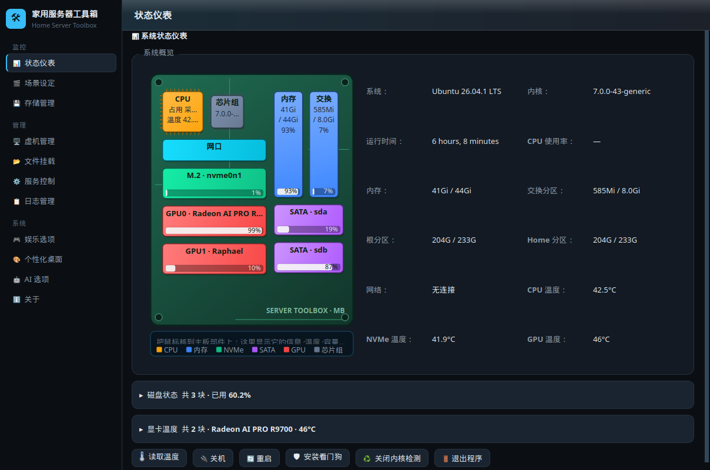

# 家用服务器工具箱 (Home Server Toolbox)

**简体中文** · [English](README.en.md) · [繁體中文](README.zh-TW.md)
<!-- 本文件与 README.en.md / README.zh-TW.md 逐节对应。改了这一份请同步另两份：
     标题结构与代码块必须一一对齐，代码块里只翻注释、命令本体一个字节都不动。 -->

一个基于 Qt6 的 Linux 桌面工具，用于管理家庭服务器的各种功能。



 **我与 Claude 不共戴天**

> 界面为深色机房控制台风格，配色令牌与实现说明见 [doc/THEME.md](doc/THEME.md)；
> 另有 4 套风格化 HTML 设计稿在 [doc/demos/](doc/demos/)。

## 功能

- **📊 状态仪表** — 系统资源监控（CPU、内存、磁盘、网络）
- **🎬 场景设定** — 按时间段自动启动 / 停止指定服务与虚机
  - 场景增删改，可为每个场景设置开始 / 结束时间与重复星期
  - 不同场景可分别控制多项系统 / 用户服务，以及虚机管理中的虚机
  - 定时执行需要保持工具箱运行，配置保存在 `~/.config/ServerToolbox/scenes.toml`
- **💾 存储管理** — 块设备树形查看、分区挂载、S.M.A.R.T 健康检测
  - **就绪状态检测** — 自动比对 `/etc/fstab` 与实际挂载点，显示分区「就绪/未就绪/未配置」状态
  - **隐藏 loop 设备** — 默认过滤 ISO、Snap、AppImage 等 loop 镜像挂载条目，可勾选显示；刷新时尽量保留当前选中的真实设备
- **🖥️ 虚机管理** — QEMU/KVM 与 VirtualBox 虚拟机的一站式管理
  - 可视化编辑虚机配置（CPU、内存、磁盘、网络、端口转发等）
  - 统一磁盘列表：系统盘（启动盘，可选 virtio/SATA/IDE 接口）与数据盘在同一列表管理，支持 qemu-img / VBoxManage 建盘
  - 硬件直通（PCI 设备、Hugepages）
  - 「网络设置」统一组：QEMU（user/bridge/tap + 网卡型号 + VNC）、VirtualBox（NAT/桥接 + 网卡型号 + 桥接网卡）
  - VirtualBox 专属：目标 OS（含 64-bit 预设）、UEFI/BIOS 固件、ACPI/IOAPIC、RDP 远程控制（VRDE）
  - VirtualBox NAT 端口转发（写入 --natpf1，重复启动时先删旧规则再重建）
  - 自动启动
  - **等待挂载点** — 启动前主动挂载 fstab 中未就绪的设备，解决硬盘开机延迟挂载问题
  - 一键启动/停止，VNC 连接
- **🎮 娱乐选项** — 音量及分辨率控制 [实验性]
- **🤖 AI 选项** — AI 对话
- **⚙️ 服务控制** — 管理系统服务
- **📋 日志管理** — 应用日志 + 系统日志查看
- **📂 文件挂载** — 磁盘设备挂载管理
- **📁 NAS** — 挑分区拖线组 RAID，导出 iSCSI / SMB 或挂成 /mnt 目录
  - **一键安装依赖的组件** — 页顶通栏橘黄按钮，认得 `dnf` / `apt-get` / `pacman` 三家：
    先弹确认框（缺什么 → 装哪些包、会跑哪几条命令，装不了的如实说装不了），
    再要 sudo 密码，包管理器的输出实时进页面上的日志框；装失败贴原话，不假装成功
  - 装齐之后按钮和右上角那句「缺少：…」一起消失；再缺东西时任何一次刷新都会让它回来
  - `configfs` 没挂载、内核里没有 LIO 模块、nasrs 引擎不在 —— 这几样**装包补不了**，
    所以不写在「缺少：…」里（否则会出现"按钮消失了却还在提示缺东西"），
    而是单独写在导出页底部，附现成的处置命令；只在 iSCSI 出口下才提它们
  - 包名按各家叫法给（Debian/Ubuntu 是 `targetcli-fb`、`samba-common-bin`；
    Arch 官方仓库没有 targetcli，就不塞 AUR 包骗人）
  - **软件镜像 RAID1（`nasrs mirror`）** — 选正好两个分区：两边都是完整的目录副本，
    访问者读其中一份。它是三条路线里唯一**现在就能用到底**的一条 ——
    不要 root、不要内核模块、不要 NBD/LIO，连同步本身都不走 pkexec
    - 可用容量是**一份**，不是两块之和。两份落在同一块盘上时红字说清后果（这块盘
      一坏，两份一起没 = 零冗余），右边给一个「知道了」：点了就放行同步与查副本。
      **不硬性挡死** —— 拿它当同一块盘上的备份目录是正当用法，防误删有用、防坏盘
      没用，界面不该替用户决定他不需要一份拷贝。确认记的是**这一对分区**，换分区
      组合就要重新确认（用布尔记的话，一次无关的确认会永久放行最该挡的那条）；
      每 5 分钟那个定时同步也过同一道闸。成员数量不是 2 这条**不给**「知道了」：
      谁是主、坏了顶哪份都没定义，点一下不会让语义变清楚。
    - 同步**只增不删**：主网上误删的文件不会跟着同步过去。要清掉副本上多余的，
      得单独勾选，并且和建阵列一样手输卷名确认
    - 出口只有 SMB（它交出来的是目录，不是块设备）；可以选对外读主副本还是副本网，
      读副本网时共享**强制只读** —— 访客写进去的东西会被下一次同步无声盖掉，
      那比一开始就不给写更糟

## 依赖

- Qt6 (Core, Widgets)
- emoji 字体（界面图标用；多数发行版默认不带，缺了图标显示成 `□`，见「图标字体」）
- toml++ (C++17 TOML 解析库，已集成)
- QEMU (运行时，虚机管理需要)
- `systemd` (服务管理需要)

## 构建

```bash
# 安装依赖 (Arch Linux / Manjaro)
sudo pacman -S qt6-base cmake gcc

# 构建
mkdir build && cd build
cmake ..
make -j$(nproc)

# 运行
./server-toolbox
```

## 配置文件

虚拟机配置存储在 `~/.config/ServerToolbox/vms.toml`，使用 TOML 格式。

## 看门狗自动重启

工具提供 `servertoolbox-watchdog` 系统服务（root 权限，开机自启）。它周期探测 nginx 端口；一旦 nginx 拒绝连接，立即对 SSH 做**协议握手**验证。当 **nginx 拒绝连接且 SSH 无法完成握手**（连接被拒、卡死无响应或超时，即系统 userspace 异常但内核尚存）时，会自动重启本机。

- SSH 健康判定以收到 `SSH-...` 协议标识串为准，而非仅 TCP 连通：sshd 卡死或系统挂起时内核仍可能替监听套接字完成三次握手，只看端口会漏判。
- 触发前会检查**重启冷却期**（`cooldown_sec`），避免频繁重启。
- 重启采用**分层降级**：先尝试 `systemctl reboot`（干净重启），若 15 秒内系统仍无响应，则通过内核 **Magic SysRq**（`sync → umount → reboot`）硬重启，绕过所有 userspace。
- 在「状态」页面点击 **🛡 安装看门狗** 可配置并安装该服务。安装对话框中可勾选 **同时配置内核级死机检测**，复用同一次 sudo 密码一并完成；还可设定 **机器中途休息**（每周定时优雅重启，见下节）；另提供 **🔄 测试硬重启** 按钮与 **♻️ 关闭内核检测** 入口。

### 内核级死机检测

安装看门狗时可一并开启内核级死机检测（写入 `/etc/sysctl.d/95-servertoolbox-hang.conf`，可随时通过「♻️ 关闭内核检测」移除）：

- `softlockup_panic` / `hardlockup_panic` / `panic_on_oops`：CPU 锁死（硬锁死走 NMI，关中断也能检测）或内核 oops 时触发 panic，配合 `kernel.panic = 10` 在 10 秒后自动重启。
- `kdump`：崩溃时由 crash kernel 抓取 vmcore 与内核日志到 `/var/crash/`（`crashkernel` 内存已在启动参数中预留）。
- `hung_task_panic`（默认关闭）：进程 D 状态卡死超过 120s 也自动重启；对磁盘/IO 卡死最有效，但可能因合法的大 I/O 误重启，需要时再勾选。

> 说明：内核级检测依赖内核自身的检测线程仍能运行；若整机彻底冻结（连 NMI 都无法进入），仍需硬件看门狗或外置断电复位。

### 机器中途休息（每周定时优雅重启）

安装看门狗时可勾选 **机器中途休息（每周定时优雅重启）**：选定每周的休息日（周一…周日，可多选）与一个时间段（`HH:mm → HH:mm`），看门狗会在**进入时间段的第一个检测周期**自动重启本机，用于在低峰时段让机器"休息"。

- 走优雅重启（`systemctl reboot`），15 秒未生效则回退内核级 Magic SysRq 硬重启。
- 每个休息日最多触发一次：执行日期写入配置的 `rest_last_run`，重启后守护进程随开机自启，不会在同一个窗口里循环重启。
- 起始时间晚于结束时间表示**跨午夜窗口**（如 22:00 → 02:00，归属起始日）。
- 配置项位于 `~/.config/ServerToolbox/health.toml`：`rest_enabled`、`rest_days`（ISO 星期，1=周一 … 7=周日）、`rest_start`、`rest_end`、`rest_last_run`。

### 强制重启命令行

`server-toolbox` 支持 `--force-reboot` 参数，会直接执行上述内核级硬重启（需要 root 权限）：

```bash
sudo server-toolbox --force-reboot
```

> 说明：`--force-reboot` 通过写入 `/proc/sys/kernel/sysrq` 触发重启，仅在内核可响应时有效；非 root 下会因权限失败而不触发。

## 安装到本地

运行 `build-install.sh` 会自动安装系统依赖、编译并将程序安装到 `~/.local/bin`：

```bash
./build-install.sh
# 或（首次安装依赖时）
sudo ./build-install.sh
```

安装后通过 `~/.local/bin/server-toolbox` 运行。若该路径未在你的 `PATH` 中，可执行 `export PATH="$HOME/.local/bin:$PATH"`。

## 图标字体

界面里的 📊💾🖥️📂⚙️ 等图标是 Unicode emoji，由字体渲染。**多数发行版默认不带
emoji 字体**（Ubuntu server 完全没有，`fc-list | grep -ci emoji` 得 0），图标会
渲染成 `□`。

装上字体通常还不够 —— 还需要 fontconfig 的 emoji 通用名重写规则，它由包的
maintainer script 安装。只解包字体文件（`dpkg-deb -x`）而不跑安装脚本时规则
缺失，症状是 `fc-list` 能列出字体、`fc-match emoji` 也正常，但按字符匹配仍拿
不到 emoji 字体。

```bash
sudo apt install fonts-noto-color-emoji    # Debian/Ubuntu
sudo pacman -S noto-fonts-emoji            # Arch
# 无 sudo 时：字体放 ~/.local/share/fonts/，再补一条 fontconfig 规则
mkdir -p ~/.config/fontconfig/fonts
cat > ~/.config/fontconfig/fonts/99-emoji-fallback.conf <<'EOF'
<?xml version="1.0"?>
<!DOCTYPE fontconfig SYSTEM "fonts.dtd">
<fontconfig>
  <match target="pattern">
    <test qual="any" name="family"><string>emoji</string></test>
    <edit name="family" mode="assign" binding="same"><string>Noto Color Emoji</string></edit>
  </match>
</fontconfig>
EOF
fc-cache -f
```

验证要用 Qt 的判据，别用 `fc-match <字符>` —— 该命令行不做 charset 匹配，
只证明字体没被索引，不能证明渲染会缺字：

```cpp
QFontMetricsF fm(QFont());        // 真实回退链下的覆盖情况
fm.inFontUcs4(0x1F4CA);           // true = 能画出来
```

`U+FE0F`（变体选择符）在 `inFontUcs4` 下恒为 false，属正常 —— 它本就不该有字形。
实测它在 Qt 里不会画成方块，代码里保留 `⚠️` `▶️` 这类带 FE0F 的写法是安全的。

AppImage 已内置该字体，不受本节影响。

### LIO / iSCSI 的几个坑（本机实证）

导出块设备要加载的是 **target_core_iblock**（= IBLOCK = `/backstores/block`），
不是名字看起来更贴切的 `target_core_file` —— 后者是 FILEIO，对应
`/backstores/fileio`，加载它之后 `/backstores/` 下压根不会出现 `block`。

| 模块 | modinfo description | 对应 backstore |
|---|---|---|
| `target_core_iblock` | TCM IBLOCK subsystem plugin | `block`（块设备） |
| `target_core_file` | TCM FILEIO subsystem plugin | `fileio`（普通文件） |
| `target_core_user` | TCM USER subsystem plugin | `user`（用户态，depends uio） |

持久化：`targetcli saveconfig` 在 Ubuntu 上写到
**`/etc/rtslib-fb-target/saveconfig.json`**，不是老文档里的 `/etc/target/saveconfig.json`。
开机恢复单元 `target.service`（`targetctl restore`）由 **python3-rtslib-fb** 提供，
`targetcli-fb` 只装 `targetclid.service/socket` —— 只装 targetcli 不会有自动恢复。

自研引擎 v1 走 `nasrs → loop → LIO block`，**不走 TCMU**：crates.io 上
`tcmu`/`libtcmu`/`tcmu-rs` 全部不存在，GitHub 上只有两个多年停更的实验仓库，
自己裸写 uio + netlink 是按周起的工作量。

镜像那条是另一回事，走 `nasrs mirror`：纯用户态的**单向**拷贝 ——
临时文件写完 `sync_all` 再 `rename`，mtime 用 `utimensat` 保住，所以第二轮
只拷真正变过的文件。不一致一律以主网为准，**不比时间戳**（时钟不可信）。
它不碰 NBD 也不碰 LIO，因此上面那条导出层的坑完全不在它的路径上：
RAID0 还停在"算得出布局、导不出去"（`serve` 直接退出码 3），镜像已经能天天用。


## 打包 AppImage

字体已随包（约 27 MB）。`EMOJI_FONT=none` 可去掉字体（省 9.5 MB），
`EMOJI_FONT=/path/to.ttf` 可指定别的字体。

一条命令产出单文件可执行程序（免安装，拷到别的 x86_64 Linux 上直接跑）：

```bash
./packaging/build-appimage.sh
# → dist/server-toolbox-1.0.0-x86_64.AppImage
VERSION=1.2.0 ./packaging/build-appimage.sh     # 自定义版本号
```

适用面是**有 X / GL 的桌面机器**，不是无头服务器：libGL、libEGL、X11 按通行做法留给宿主，
所以在一台没装 GL 的服务器（本机 openEuler 26.09 就是）上跑会停在
`libEGL.so.1: cannot open shared object file`。要在这类机器上跑，用容器镜像
（`Containerfile`，里面带 mesa 与 libglvnd）。

打包范围：程序本体 + `llama-proxy` + **`nasrs`（自研引擎）** + **Qt 自己的库和插件**
（core/gui/widgets/network/dbus、xcb / wayland 平台插件、imageformats），外加
**`libproxy`**（QtGui 的直接依赖，14 KB，服务器发行版常不装）。libc、libGL、X11、
ICU 等系统库一律不打进去 —— AppImage 的通行做法是依赖宿主已有的系统库，把 glibc 打包反而会在
别的发行版上崩。

自检做三件事，不是"打包机上能跑"那种：
1. AppDir 结构（AppRun / desktop / 图标 / Qt 库 / 平台插件 / emoji 字体 / nasrs）；
2. **依赖闭合**：把包内 `usr/lib` 当成唯一库路径，看谁还 `not found`（白名单里的系统库
   过滤掉，剩下的就是真缺口）；
3. AppRun 必须把包内 `usr/lib` 写进 `LD_LIBRARY_PATH` —— 少了这条，在装了 Qt 的机器上
   照样起（用的是系统 Qt，捆绑那份白打了），到没装 Qt 的机器上才炸。

`nasrs` 少了会**直接终止打包**：少一个引擎属于"产出一个残废包"——包照样能启动，界面只在选
自研引擎时说一句"引擎不在程序旁边"，靠启动自检是发现不了的。确实要打一个不含自研引擎的包，
设 `ALLOW_MISSING_NASRS=1`。emoji 字体与许可证的查找认 Debian 和 RPM 两种布局
（`/usr/share/fonts/truetype/noto/` 与 `/usr/share/fonts/google-noto-emoji/`、
`/usr/share/licenses/…`），在 openEuler 上打出来的包字体是齐的。

跑之前需要 appimagetool 一次：

```bash
curl -L -o build/appimagetool \
  https://github.com/AppImage/appimagetool/releases/download/continuous/appimagetool-x86_64.AppImage
chmod +x build/appimagetool
```

在**没有 FUSE 的环境**（容器、CI）里跑 AppImage 或 appimagetool，加
`export APPIMAGE_EXTRACT_AND_RUN=1` 绕开挂载。

## 顶部截图

顶部那张图是 `doc/img/screenshot.png`（仓库里的静态图）。
**无头截图脚手架（`preview/` 下的 `app_shot`、`board_shot` 与全部界面探针）已整体移除**，
所以改了界面之后没法再用一条命令重生成这张图 —— 界面验收请在真实桌面上做。
要换图：在桌面上截图，覆盖 `doc/img/screenshot.png` 即可。

## 许可证

MIT License
