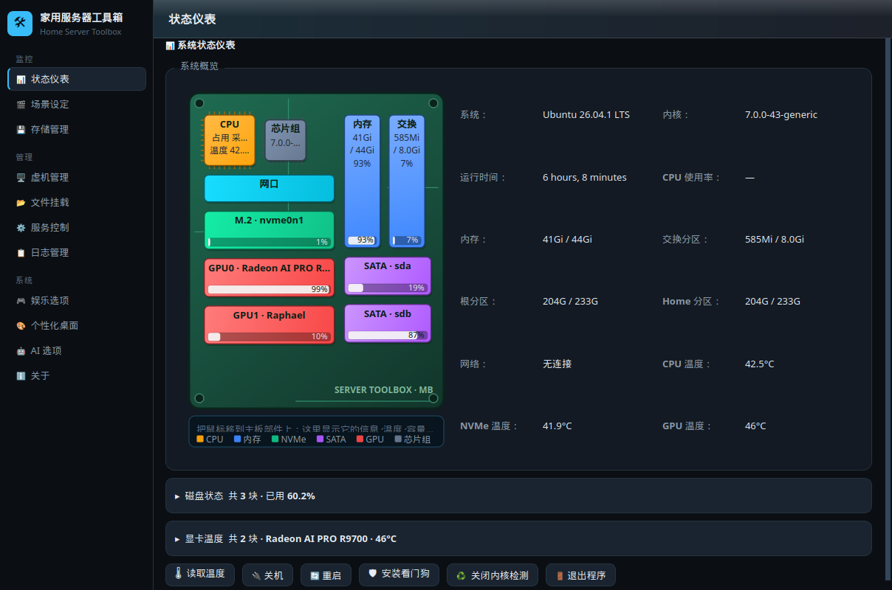

# 家用伺服器工具箱

[简体中文](README.md) · [English](README.en.md) · **繁體中文**
<!-- 本檔案與 README.md / README.en.md 逐節對應。改了這一份請同步另兩份：
     標題結構與程式碼區塊必須一一對齊，程式碼區塊裡只翻註解、命令本體一個位元組都不動。 -->

一個基於 Qt6 的 Linux 桌面工具，用來管理家用伺服器的各種功能。



 **我與 Claude 不共戴天**

> 介面採深色機房控制台風格；配色權杖與實作說明見 [doc/THEME.md](doc/THEME.md)；
> 另有 4 組風格化 HTML 設計稿在 [doc/demos/](doc/demos/)。

## 功能

- **📊 狀態儀表** — 系統資源監控（CPU、記憶體、磁碟、網路）
- **🎬 情境設定** — 依時間區段自動啟動 / 停止指定的服務與虛擬機
  - 情境可新增、修改、刪除，每個情境可設定開始 / 結束時間與重複的星期
  - 不同情境可分別控制多個系統 / 使用者服務，以及虛擬機管理裡的虛擬機
  - 排程執行需要讓工具箱持續開著，設定存在 `~/.config/ServerToolbox/scenes.toml`
- **💾 儲存管理** — 區塊裝置樹狀檢視、分割區掛載、S.M.A.R.T 健康檢查
  - **就緒狀態偵測** — 自動比對 `/etc/fstab` 與實際掛載點，顯示分割區「就緒 / 未就緒 / 未設定」狀態
  - **隱藏 loop 裝置** — 預設過濾 ISO、Snap、AppImage 等 loop 映像掛載項目，可勾選顯示；重新整理時盡量保留目前選取的一般裝置
- **🖥️ 虛擬機管理** — QEMU/KVM 與 VirtualBox 虛擬機的一站式管理
  - 可視化編輯虛擬機設定（CPU、記憶體、磁碟、網路、連接埠轉發等）
  - 統一的磁碟清單：系統碟（開機碟，可選 virtio/SATA/IDE 介面）與資料碟在同一個清單管理，支援 qemu-img / VBoxManage 建碟
  - 硬體直通（PCI 裝置、Hugepages）
  - 「網路設定」統一成一組：QEMU（user/bridge/tap + 網路卡型號 + VNC）、VirtualBox（NAT/橋接 + 網路卡型號 + 橋接網路卡）
  - VirtualBox 專屬：目標 OS（含 64-bit 預設值）、UEFI/BIOS 韌體、ACPI/IOAPIC、RDP 遠端控制（VRDE）
  - VirtualBox NAT 連接埠轉發（寫入 `--natpf1`，重複啟動時先刪除舊規則再重建）
  - 開機自動啟動
  - **等待掛載點** — 啟動前主動掛載 fstab 中尚未就緒的裝置，解決硬碟開機時延遲掛載的問題
  - 一鍵啟動 / 停止，VNC 連線
- **🎮 娛樂選項** — 音量與解析度控制 [實驗性]
- **🤖 AI 選項** — AI 對話
- **⚙️ 服務控制** — 管理系統服務
- **📋 日誌管理** — 應用程式日誌 + 系統日誌檢視
- **📂 檔案掛載** — 磁碟裝置掛載管理
- **📁 NAS** — 挑選分割區、拉線組成 RAID，匯出成 iSCSI / SMB 或掛載成 `/mnt` 目錄
  - **點擊此按鈕一鍵安裝相依的元件** — 頁面最上方的整條橘黃色通欄按鈕，認得 `dnf` /
    `apt-get` / `pacman` 三家：先跳出確認對話框（缺什麼 → 要裝哪些套件、會跑哪幾條命令，
    裝不了的就老實說裝不了），接著要 sudo 密碼，套件管理器的輸出會即時顯示在介面上的
    日誌區；裝失敗就把它的原話貼給你，不會假裝成功
  - 裝齊之後，按鈕與右上角那句「缺少：…」會一起消失；之後再缺東西時，任何一次重新整理
    都會讓它們回來
  - `configfs` 沒掛載、核心裡沒有 LIO 模組、nasrs 引擎不在 — 這幾樣**裝套件補不了**，
    所以刻意不寫進「缺少：…」裡（否則就會出現「按鈕不見了卻還在提示缺東西」這種自相
    矛盾的畫面），而是另外寫在匯出頁的下方，並附上現成的處置命令；而且只有在 iSCSI
    匯出這條路上才會提到它們
  - 套件名依各家的叫法給（Debian/Ubuntu 是 `targetcli-fb`、`samba-common-bin`；Arch 官方
    倉庫裡沒有 targetcli，就不塞 AUR 套件來騙畫面）
  - **軟體鏡像 RAID1（`nasrs mirror`）** — 選剛好兩個分割區：兩邊都是完整的目錄副本，
    拜訪者讀其中一份。這是三條路線裡唯一**現在就能用到底**的一條 ——
    不要 root、不要核心模組、不要 NBD/LIO，連同步本身都不走 pkexec
    - 可用容量是**一份**，不是兩塊加總。兩份落在同一塊盤上時紅字說清後果（這塊盤
      一壞，兩份一起沒 = 零冗餘），右邊給一個「知道了」：點了就放行同步與查副本。
      **不硬性擋死** —— 拿它當同一塊盤上的備份目錄是正當用法，防誤刪有用、防壞盤
      沒用，介面不該替使用者決定他不需要一份拷貝。確認記的是**這一對分割區**，換
      分割區組合就要重新確認（用布林記的話，一次無關的確認會永久放行最該擋的那條）；
      每 5 分鐘那個定時同步也過同一道閘。成員數量不是 2 這條**不給**「知道了」：
      誰是主、壞了頂哪份都沒定義，點一下不會讓語義變清楚。
    - 同步**只增不刪**：主網誤刪的檔案不會跟著同步過去。要清掉副本上多出來的，
      得單獨勾選，並且和建陣列一樣手輸卷名確認
    - 出口只有 SMB（它交出來的是目錄，不是區塊裝置）；可以選對外讀主副本還是副本网，
      讀副本网時共享**強制唯讀** —— 拜訪者寫進去的东西會被下一次同步無聲蓋掉，
      那比一開始就不給寫更糟

## 相依套件

- Qt6 (Core, Widgets)
- emoji 字型（介面圖示用；多數發行版預設不附，少了圖示會顯示成 `□`，見「emoji 字型」）
- toml++（C++17 的 TOML 解析程式庫，已內含）
- QEMU（執行期需要，虛擬機管理要用）
- `systemd`（服務管理需要）

## 建置

```bash
# 安裝相依套件 (Arch Linux / Manjaro)
sudo pacman -S qt6-base cmake gcc

# 建置
mkdir build && cd build
cmake ..
make -j$(nproc)

# 執行
./server-toolbox
```

## 設定檔

虛擬機設定存放在 `~/.config/ServerToolbox/vms.toml`，使用 TOML 格式。

## 看門狗自動重新開機

本工具提供 `servertoolbox-watchdog` 系統服務（root 權限，開機自動啟動）。它會定期偵測 nginx
連接埠；一旦 nginx 拒絕連線，立刻對 SSH 做**協定交握**驗證。當 **nginx 拒絕連線且 SSH 無法完成
交握**（連線被拒、卡住不回應或逾時，也就是使用者的程式空間出問題但核心還在）時，會自動重新
開機。

- SSH 的健康判定以收到 `SSH-...` 協定識別字串為準，而不只是 TCP 是否連通：sshd 卡死或系統掛起
  時，核心仍可能替監聽的 socket 完成三次交握，只看連接埠會漏判。
- 觸發前會檢查**重新開機冷卻期**（`cooldown_sec`），避免頻繁重開。
- 重新開機採**分層降級**：先試 `systemctl reboot`（正常重開），若 15 秒內系統仍無回應，就透過
  核心的 **Magic SysRq**（`sync → umount → reboot`）硬重開，繞過所有使用者程式空間。
- 在「狀態」頁面點 **🛡 安裝看門狗** 即可設定並安裝該服務。安裝對話框裡可以勾選 **同時設定
  核心層當機偵測**，沿用同一次 sudo 密碼一併完成；也可以設定 **機器中途休息**（每週排程的
  正常重開，見下一節）；另外還有 **🔄 測試硬重開** 按鈕與 **♻️ 關閉核心偵測** 入口。

### 核心層當機偵測

安裝看門狗時可以一併啟用核心層當機偵測（寫入 `/etc/sysctl.d/95-servertoolbox-hang.conf`，隨時可用
「♻️ 關閉核心偵測」移除）：

- `softlockup_panic` / `hardlockup_panic` / `panic_on_oops`：CPU 鎖死（硬鎖死走 NMI，關中斷也偵測
  得到）或核心 oops 時觸發 panic，搭配 `kernel.panic = 10` 在 10 秒後自動重開。
- `kdump`：當機時由 crash kernel 把 vmcore 與核心日誌擷取到 `/var/crash/`（`crashkernel` 的記憶體
  已在開機參數中預留）。
- `hung_task_panic`（預設關閉）：程序卡在 D 狀態超過 120 秒也自動重開；對磁碟 / IO 卡死最有效，
  但可能因為合法的大 IO 而誤重開，需要時再勾選。

> 說明：核心層偵測依賴核心自己的偵測執行緒還能跑；若整台機器完全凍結（連 NMI 都進不去），
> 仍需要硬體看門狗或外部的斷電重啟。

### 機器中途休息（每週排程的正常重開）

安裝看門狗時可以勾選 **機器中途休息（每週排程的正常重開）**：選取每週的休息日（星期一…
星期日，可多選）與一個時間區段（`HH:mm → HH:mm`），看門狗會在**進入該區段的第一個檢查週期**
自動重新開機，用途是在離峰時段讓機器「休息一下」。

- 走正常重開（`systemctl reboot`），15 秒沒生效就退回核心層的 Magic SysRq 硬重開。
- 每個休息日最多觸發一次：執行日期會寫進設定檔的 `rest_last_run`，重新開機後守護程式隨開機
  自動啟動，不會在同一個視窗裡迴圈重開。
- 開始時間晚於結束時間代表**跨午夜的時間區段**（例如 22:00 → 02:00，歸屬開始那一天）。
- 設定項在 `~/.config/ServerToolbox/health.toml`：`rest_enabled`、`rest_days`（ISO 星期，1 = 星期一
  … 7 = 星期日）、`rest_start`、`rest_end`、`rest_last_run`。

### 強制重新開機的命令列參數

`server-toolbox` 支援 `--force-reboot` 參數，會直接執行上述的核心層硬重開（需要 root 權限）：

```bash
sudo server-toolbox --force-reboot
```

> 說明：`--force-reboot` 透過寫入 `/proc/sys/kernel/sysrq` 觸發重開，只對核心還能回應時有效；
> 非 root 下會因為權限不足而失敗，不會觸發。

## 安裝到本機

執行 `build-install.sh` 會自動安裝系統相依套件、編譯，並把程式安裝到 `~/.local/bin`：

```bash
./build-install.sh
# 或（第一次安裝相依套件時）
sudo ./build-install.sh
```

安裝後透過 `~/.local/bin/server-toolbox` 執行。若該路徑不在你的 `PATH` 裡，可以執行
`export PATH="$HOME/.local/bin:$PATH"`。

## emoji 字型

介面裡的 📊💾🖥️📂⚙️ 等圖示是 Unicode emoji，由字型渲染。**多數發行版預設不附 emoji 字型**
（Ubuntu server 完全沒有，`fc-list | grep -ci emoji` 得到 0），圖示會渲染成 `□`。

裝上字型通常還不夠 — 還需要 fontconfig 的 emoji 通用名稱改寫規則，它是由套件 maintainer script
安裝的。只解開字型檔（`dpkg-deb -x`）而沒跑安裝腳本時規則缺失，症狀是 `fc-list` 列得出字型、
`fc-match emoji` 也正常，但依字元比對仍然拿不到 emoji 字型。

```bash
sudo apt install fonts-noto-color-emoji    # Debian/Ubuntu
sudo pacman -S noto-fonts-emoji            # Arch
# 沒有 sudo 時：字型放 ~/.local/share/fonts/，再補一條 fontconfig 規則
mkdir -p ~/.config/fontconfig/fonts
cat > ~/.config/fontconfig/fonts/99-emoji-fallback.conf <<'EOF'
<?xml version="1.0"?>
<!DOCTYPE fontconfig SYSTEM "fonts.dtd">
<fontconfig>
  <match target="pattern">
    <test qual="any" name="family"><string>emoji</string></test>
    <edit name="family" mode="assign" binding="same"><string>Noto Color Emoji</string></edit>
  </match>
</fontconfig>
EOF
fc-cache -f
```

驗證要用 Qt 自己的判準，別用 `fc-match <字元>` — 那個命令列不做 charset 比對，只能證明字型沒
被索引，不能證明渲染時會不會缺字：

```cpp
QFontMetricsF fm(QFont());        // 真實 fallback 鏈下的覆蓋狀況
fm.inFontUcs4(0x1F4CA);           // true = 畫得出來
```

`U+FE0F`（變體選擇字元）在 `inFontUcs4` 下恆為 false，這是正常的 — 它本來就不該有字形。實測
它在 Qt 裡也不會畫成方塊，程式裡保留 `⚠️` `▶️` 這類附帶 FE0F 的寫法是安全的。

AppImage 已內建該字型，不受本節影響。

### LIO / iSCSI 的幾個坑（本機實證）

匯出區塊裝置要載入的是 **target_core_iblock**（= IBLOCK = `/backstores/block`），不是名字看起來
更貼切的 `target_core_file` — 後者是 FILEIO，對應 `/backstores/fileio`，載入它之後 `/backstores/`
底下根本不會出現 `block`。

| 模組 | modinfo description | 對應的 backstore |
|---|---|---|
| `target_core_iblock` | TCM IBLOCK subsystem plugin | `block`（區塊裝置） |
| `target_core_file` | TCM FILEIO subsystem plugin | `fileio`（一般檔案） |
| `target_core_user` | TCM USER subsystem plugin | `user`（使用者空間，依賴 uio） |

持久化：`targetcli saveconfig` 在 Ubuntu 上寫到 **`/etc/rtslib-fb-target/saveconfig.json`**，不是
舊文件裡的 `/etc/target/saveconfig.json`。開機復原的單元 `target.service`（`targetctl restore`）由
**python3-rtslib-fb** 提供，`targetcli-fb` 只裝 `targetclid.service/socket` — 只裝 targetcli 不會有
自動復原。

自研引擎 v1 走 `nasrs → loop → LIO block`，**不走 TCMU**：crates.io 上 `tcmu`/`libtcmu`/`tcmu-rs`
全部不存在，GitHub 上只有兩個多年未更新的實驗倉庫，自己裸寫 uio + netlink 是以「週」為單位的
工作量。

鏡像那條是另一回事，走 `nasrs mirror`：純使用者態的**單向**複製 ——
先寫暫存檔、`sync_all`、再 `rename`，mtime 用 `utimensat` 保住，所以第二輪只複製真的變過的
檔案。不一致一律以主網為準，**不比時間戳**（時鐘不可信）。它不碰 NBD 也不碰 LIO，所以上面
那堆匯出層的坑完全不在它的路徑上：RAID0 還停在「算得出佈局、匯不出去」（`serve` 直接退出碼 3），
鏡像已經可以天天用。

## 打包成 AppImage

字型已隨套件（約 27 MB）。`EMOJI_FONT=none` 可以去掉字型（省下 9.5 MB），
`EMOJI_FONT=/path/to.ttf` 可以指定別的字型。

一條命令產出單檔可執行檔（免安裝，複製到別的 x86_64 Linux 上直接跑）：

```bash
./packaging/build-appimage.sh
# → dist/server-toolbox-1.0.0-x86_64.AppImage
VERSION=1.2.0 ./packaging/build-appimage.sh     # 自訂版本號
```

適用範圍是**有 X / GL 的桌面機器**，不是無頭伺服器：libGL、libEGL、X11 依通行作法留給宿主，
所以在沒裝 GL 的伺服器上跑（本機 openEuler 26.09 就是）會停在
`libEGL.so.1: cannot open shared object file`。要在這類機器上跑，用容器映像檔
（`Containerfile`，裡面附了 mesa 與 libglvnd）。

打包範圍：程式本體 + `llama-proxy` + **`nasrs`（自研引擎）** + **Qt 自己的函式庫與外掛**
（core/gui/widgets/network/dbus、xcb / wayland 平台外掛、imageformats），外加
**`libproxy`**（QtGui 的直接依賴，14 KB，伺服器發行版常不裝）。libc、libGL、X11、ICU
等系統函式庫一律不打包進去 — AppImage 的通行作法是依賴宿主端既有的系統函式庫，把 glibc 包進去
反而會在別的發行版上當掉。

自我檢查做三件事，沒一件是「打包機上能跑」：
1. AppDir 結構（AppRun / desktop / 圖示 / Qt 函式庫 / 平台外掛 / emoji 字型 / nasrs）；
2. **依賴閉合**：把包內 `usr/lib` 當成唯一的庫路徑，看誰還 `not found`（白名單裡的系統函式庫
   過濾掉，剩下的就是真缺口）；
3. AppRun 必須把包內 `usr/lib` 寫進 `LD_LIBRARY_PATH` —— 少了這一行，在裝了 Qt 的機器上
   照常起（用的是系統 Qt，捆绑那份白打），到沒裝 Qt 的機器上才炸。

`nasrs` 少了會**直接終止打包**：少一個引擎屬於「產出一個殘廢包」— 包照常啟動，介面只在選自研
引擎時說一句「引擎不在程式旁邊」，靠啟動自我檢查是發現不了的。真的要打一個不含自研引擎的包，
設 `ALLOW_MISSING_NASRS=1`。emoji 字型與授權檔的尋找同時認 Debian 和 RPM 兩種佈局
（`/usr/share/fonts/truetype/noto/` 與 `/usr/share/fonts/google-noto-emoji/`、
`/usr/share/licenses/…`），在 openEuler 上打出來的包字型是齊的。

跑之前需要一次 appimagetool：

```bash
curl -L -o build/appimagetool \
  https://github.com/AppImage/appimagetool/releases/download/continuous/appimagetool-x86_64.AppImage
chmod +x build/appimagetool
```

在**沒有 FUSE 的環境**（容器、CI）裡跑 AppImage 或 appimagetool，加上
`export APPIMAGE_EXTRACT_AND_RUN=1` 繞開掛載。

## 更新上方的截圖

最上面那張圖是 `app_shot` 在無頭環境渲染出來的，改了介面後依下面的方式重新產生：

```bash
cmake -S . -B build -DENABLE_THEME_SHOT=ON && cmake --build build -j
QT_QPA_PLATFORM=offscreen ./build/app_shot          # → build/app_main.png
cp build/app_main.png doc/img/screenshot.png        # 上方的主畫面用這張
```

`app_shot <n>` 渲染第 n 個導覽頁（例如 `./build/app_shot 2` 出儲存管理）；第三個參數是捲動
像素，`./build/app_shot - 230` 可以用來看頂欄的毛玻璃 — 靜態的首屏時玻璃背後只有頁面邊距，
捲動起來才看得出模糊。

截圖前先確認 emoji 字型可用，否則圖示會全是 `□`，見上一節。

## 授權

MIT License
